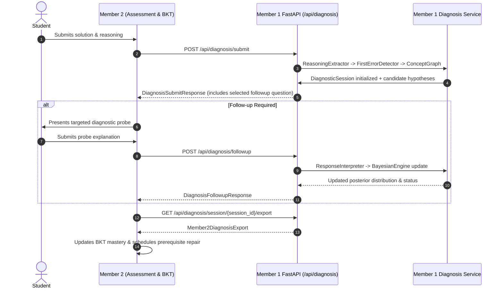

# MINDTRACE — Diagnosis Engine & Member 2 Integration API Contract

## Overview

This document specifies the integration interface between **Member 1 (Learning Intelligence & Reasoning Diagnosis Engine)** and **Member 2 (Assessment, Learner Mastery Modelling / BKT, Adaptive Question Selection, and Interventions)**.

---

## 1. Architectural Boundaries

* **Member 1 Owns**:
  * Step-by-step reasoning extraction and evidence validation.
  * First-error localization and downstream error-chain tracking.
  * Misconception candidate hypothesis retrieval.
  * Active follow-up question selection (Information Gain maximization).
  * Evidence-driven Bayesian hypothesis updates.
  * Prerequisite knowledge repair path generation from the Concept Graph.
* **Member 2 Owns**:
  * Bayesian Knowledge Tracing (BKT) and student mastery state updates.
  * Item response theory (IRT) and adaptive question recommendation.
  * Spaced repetition scheduling.
  * Teacher and student analytics dashboards.
* **Boundary Rule**:
  * Member 1 **never directly updates learner mastery scores** ($p(L)$).
  * Member 1 **never confirms a misconception** based on a single incorrect answer.
  * Member 1 exposes validated diagnostic outputs and knowledge repair paths that Member 2 consumes to calibrate BKT slip/guess parameters and select targeted remediation tasks.

---

## 2. Integration Export Contract

### Endpoint: `GET /api/diagnosis/session/{session_id}/export`

**Response Model**: `Member2DiagnosisExport`

```json
{
  "student_id": "student_101",
  "session_id": "diag_a1b2c3d4e5",
  "question_id": "Q_ACCEL_01",
  "relevant_concept_ids": ["mass", "net_force", "acceleration", "newton_second_law"],
  "first_error_concept_id": "net_force",
  "first_error_step_order": 2,
  "identified_error_category": "direction_or_sign_error",
  "candidate_misconception_ids": ["PHY_M008"],
  "posterior_hypotheses": {
    "PHY_M008": 0.8524,
    "unknown_or_other": 0.1476
  },
  "diagnostic_status": "sufficient_evidence",
  "prerequisite_concepts_to_review": [
    "force"
  ],
  "evidence_confidence": 0.90
}
```

### Field Definitions

| Field | Type | Description | Member 2 Utilization |
| :--- | :--- | :--- | :--- |
| `student_id` | `str` | Unique learner identifier. | Key for learner profile and BKT state. |
| `session_id` | `str` | Diagnostic session identifier. | Audit trail and historical correlation. |
| `question_id` | `str` | The task problem being diagnosed. | Item difficulty calibration. |
| `relevant_concept_ids` | `list[str]` | Concepts tested by the task. | Multi-concept BKT knowledge tracing. |
| `first_error_concept_id` | `Optional[str]` | Concept where reasoning first failed. | Primary target for remediation. |
| `first_error_step_order` | `Optional[int]` | Step index ($1, 2, \dots$) where reasoning derailed. | Distinguishes immediate vs. late failure. |
| `identified_error_category` | `Optional[str]` | Error type (e.g., `direction_or_sign_error`, `mathematical_error`, `conceptual_error`). | Informs slip vs. genuine conceptual deficit in BKT. |
| `candidate_misconception_ids`| `list[str]` | Competing misconception hypotheses. | Filters targeted instructional videos or tips. |
| `posterior_hypotheses` | `dict[str, float]` | Posterior probabilities across candidate hypotheses. | Quantifies belief in specific student flaws. |
| `diagnostic_status` | `str` | `collecting_evidence`, `sufficient_evidence`, `inconclusive`, `no_available_questions`. | Decides whether to allow active follow-ups or terminate. |
| `prerequisite_concepts_to_review` | `list[str]` | Ordered list of upstream prerequisites leading to the error point. | Generates prerequisite revision paths before re-attempting the target concept. |
| `evidence_confidence` | `float` | Metric ($0.0 \dots 1.0$) reflecting depth and consistency of evidence. | Weight factor for BKT observation updates. |

---

## 3. End-to-End Workflow Diagram



---

## 4. API Endpoints Reference

### 1. `POST /api/diagnosis/submit`
Initial diagnosis of student reasoning.
* **Input**: `DiagnosisSubmitRequest` (student ID, question, reasoning, rubric).
* **Output**: `DiagnosisSubmitResponse` (extracted reasoning, first error, candidate misconceptions, initial beliefs, optional follow-up probe).

### 2. `POST /api/diagnosis/followup`
Process response to a diagnostic question probe.
* **Input**: `DiagnosisFollowupRequest` (session ID, question ID, student response).
* **Output**: `DiagnosisFollowupResponse` (interpreted evidence category, updated posterior probabilities, status, next probe if needed).

### 3. `GET /api/diagnosis/concepts`
Retrieve the full Physics prerequisite concept graph.
* **Output**: `ConceptListResponse` (all 23 concepts, topology, prerequisites, descriptions).

### 4. `GET /health`
Liveness and readiness check reporting catalog sizes.
